

<a href="https://mrzroot.github.io/"><picture><source media="(prefers-color-scheme: dark)" srcset="./assets/gen/banner-dark.svg"><source media="(prefers-color-scheme: light)" srcset="./assets/gen/banner-light.svg"></picture></a>

<picture><source media="(max-width: 700px) and (prefers-color-scheme: dark)" srcset="./assets/gen/tagline-m-dark.svg"><source media="(max-width: 700px)" srcset="./assets/gen/tagline-m-light.svg"><source media="(prefers-color-scheme: dark)" srcset="./assets/gen/tagline-dark.svg"><source media="(prefers-color-scheme: light)" srcset="./assets/gen/tagline-light.svg"></picture>

<h1 align="center">Mohammadreza Zare · محمدرضا زارع</h1>

### Selected work · نمونه‌کارهای منتخب

- **[Planroom](https://github.com/mrzroot/planroom)** · Financial planning workspace demo. React dashboard and questionnaire, FastAPI and PostgreSQL, session-based login, and a Docker Compose stack with GitHub Actions checks and a Linux staging runbook. [Try the browser demo](https://mrzroot.github.io/planroom/).
- **[FlowPilot](https://github.com/mrzroot/flowpilot)** · Self-hosted Python workflow engine. FastAPI, SQLite, a dashboard with live run logs, Docker Compose, and GitHub Actions.

<b>پلن‌روم</b> از ورود مشتری و تکمیل پرسش‌نامه تا ذخیرهٔ برنامهٔ پس‌انداز را پوشش می‌دهد. <b>فلوپایلوت</b> اجرای گردش‌کارها و نمایش زندهٔ گزارش اجرای آن‌ها را در یک سرویس خودمیزبان نشان می‌دهد.

### Project lab · آزمایشگاه پروژه‌ها

Pick a preview to open the full interactive guide. The demos use sample data and run on the portfolio site.

روی هر تصویر بزنید تا صفحهٔ معرفی و دموی تعاملی باز شود. مثال‌ها با دادهٔ نمونه اجرا می‌شوند.

<table>
<tr><td valign="top" width="50%"> <b><a href="https://mrzroot.github.io/showcase/mcptape/">MCPTape</a></b> Follow messages from recording to repeatable playback.
مسیر پیام‌ها را از ضبط تا بازپخش تکرارپذیر دنبال کنید.
</td>
<td valign="top" width="50%"> <b><a href="https://mrzroot.github.io/showcase/routefall/">RouteFall</a></b> Follow a fictional request when the primary route is unavailable.
مسیر یک درخواست فرضی را هنگام قطعی سرویس اصلی دنبال کنید.
</td></tr>
<tr><td valign="top" width="50%"> <b><a href="https://mrzroot.github.io/showcase/parsieval/">Parsieval</a></b> Compare examples of Persian half-spaces, letters, digits, and writing direction.
نمونه‌های نیم‌فاصله، نویسه‌ها، ارقام و جهت نوشتار فارسی را مقایسه کنید.
</td>
<td valign="top" width="50%"> <b><a href="https://mrzroot.github.io/planroom/">Planroom</a></b> Try fictional savings goals and see how the timeline changes.
هدف‌های فرضی پس‌انداز را امتحان کنید و تغییر زمان رسیدن را ببینید.
</td></tr>
</table>

<b>Agent tooling · ابزارهای ایجنت</b>

<table>
<tr><td valign="top" width="176"></td><td valign="top"><b><a href="https://mrzroot.github.io/showcase/tokenxray/">TokenXRay</a></b> See what fills a context window before the useful information gets crowded out.
ببینید چه چیزی پنجرهٔ زمینه را پر می‌کند و جا را برای اطلاعات مفید تنگ می‌کند.
</td></tr>
<tr><td valign="top" width="176"></td><td valign="top"><b><a href="https://mrzroot.github.io/showcase/slopguard/">SlopGuard</a></b> Review suspicious package names and unsupported calls before accepting generated code.
پیش از پذیرش کد تولیدشده، نام بسته‌های مشکوک و فراخوان‌های نامعتبر را بررسی کنید.
</td></tr>
<tr><td valign="top" width="176"></td><td valign="top"><b><a href="https://mrzroot.github.io/showcase/agentfence/">AgentFence</a></b> See which hypothetical tool actions pass a policy check and which get stopped.
ببینید کدام اقدام فرضی از کنترل سیاست می‌گذرد و کدام متوقف می‌شود.
</td></tr>
<tr><td valign="top" width="176"></td><td valign="top"><b><a href="https://mrzroot.github.io/showcase/promptbisect/">PromptBisect</a></b> Narrow down which instruction revision introduced a regression.
نسخه‌ای از دستورالعمل را پیدا کنید که رفتار را تغییر داده است.
</td></tr>
<tr><td valign="top" width="176"></td><td valign="top"><b><a href="https://mrzroot.github.io/showcase/agentcontract/">AgentContract</a></b> Compare tool contracts and see which edits break existing calls.
قراردادهای ابزار را مقایسه کنید و ببینید کدام تغییر فراخوان‌های قبلی را می‌شکند.
</td></tr>
<tr><td valign="top" width="176"></td><td valign="top"><b><a href="https://mrzroot.github.io/showcase/skilltrace/">Skilltrace</a></b> Spot conflicting agent instructions and review them one at a time.
تعارض دستورهای ایجنت را پیدا کنید و موردبه‌مورد بررسی کنید.
</td></tr>
</table>

<b>Document and retrieval diagnostics · عیب‌یابی متن و بازیابی</b>

<table>
<tr><td valign="top" width="176"></td><td valign="top"><b><a href="https://mrzroot.github.io/showcase/ragxray/">RagXRay</a></b> See where chunking cuts a document and changes the search result.
ببینید قطعه‌بندی کجا سند را می‌بُرد و نتیجهٔ جست‌وجو را عوض می‌کند.
</td></tr>
</table>

[Open the interactive project map](https://mrzroot.github.io/#project-signal) · [نقشهٔ تعاملی پروژه‌ها](https://mrzroot.github.io/?lang=fa#project-signal) · [Browse all projects](https://mrzroot.github.io/projects/)

Software that <i>explains why</i> · نرم‌افزاری که می‌گوید <i>چرا</i>

<a href="https://mrzroot.github.io/"><picture><source media="(prefers-color-scheme: dark)" srcset="./assets/gen/pill-portfolio-dark.svg"><source media="(prefers-color-scheme: light)" srcset="./assets/gen/pill-portfolio-light.svg"></picture></a>
<a href="https://mrzroot.github.io/?lang=fa"><picture><source media="(prefers-color-scheme: dark)" srcset="./assets/gen/pill-fa-dark.svg"><source media="(prefers-color-scheme: light)" srcset="./assets/gen/pill-fa-light.svg">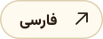</picture></a>
<a href="https://mrzroot.github.io/resume/"><picture><source media="(prefers-color-scheme: dark)" srcset="./assets/gen/pill-resume-dark.svg"><source media="(prefers-color-scheme: light)" srcset="./assets/gen/pill-resume-light.svg"></picture></a>
<a href="https://t.me/mrzroot"><picture><source media="(prefers-color-scheme: dark)" srcset="./assets/gen/pill-telegram-dark.svg"><source media="(prefers-color-scheme: light)" srcset="./assets/gen/pill-telegram-light.svg"></picture></a>
<a href="https://linkedin.com/in/mrzroot"><picture><source media="(prefers-color-scheme: dark)" srcset="./assets/gen/pill-linkedin-dark.svg"><source media="(prefers-color-scheme: light)" srcset="./assets/gen/pill-linkedin-light.svg"></picture></a>

<picture><source media="(max-width: 700px) and (prefers-color-scheme: dark)" srcset="./assets/gen/status-m-dark.svg"><source media="(max-width: 700px)" srcset="./assets/gen/status-m-light.svg"><source media="(prefers-color-scheme: dark)" srcset="./assets/gen/status-dark.svg"><source media="(prefers-color-scheme: light)" srcset="./assets/gen/status-light.svg"></picture>

I'm a software engineer in Mashhad, Iran. I build **open-source developer tools** in Python and TypeScript, mostly for **AI coding agents** and for **developers in Iran**: small, well-tested tools that tell you *why* something broke. Each one has a release, docs and its own website.

مهندس نرم‌افزارم و در مشهد زندگی می‌کنم. ابزارهای متن‌باز توسعه می‌دهم، بیشتر با پایتون و تایپ‌اسکریپت و برای <b>ایجنت‌های کدنویسی هوش مصنوعی</b> و <b>برنامه‌نویس‌های ایرانی</b>: ابزارهای کوچک و تست‌شده که می‌گویند <b>چرا</b> چیزی خراب شده. هر کدام نسخهٔ منتشرشده، مستندات و وب‌سایت خودش را دارد.

> [!TIP]
> **Open to collaboration.** Every flagship below has issues labelled [`good first issue`](https://github.com/search?q=user%3Amrzroot+label%3A%22good+first+issue%22+state%3Aopen&type=issues), and a pull request is the fastest way to say hello.
>
> 
<b>آمادهٔ همکاری‌ام.</b> هر پروژهٔ شاخص issue با برچسب <code>good first issue</code> دارد و ارسال pull request بهترین شروع آشناییست.

### Now · اکنون

<table>
<tr>
<td valign="top" width="50%"><b>Building</b> 
<a href="https://github.com/mrzroot/vazhgun">vazhgun</a>, <a href="https://github.com/mrzroot/payanlint">payanlint</a>, <a href="https://github.com/mrzroot/arjaa">arjaa</a> and <a href="https://github.com/mrzroot/neveshtar">neveshtar</a>: offline tools for a Persian Word thesis (flipped numerals, typing and format lint, figure and citation cross-references, written register).

<b>در حال ساخت</b> 
vazhgun، payanlint، arjaa و neveshtar: ابزارهای آفلاین برای پایان‌نامهٔ فارسی در ورد (اعداد وارونه، لینت تایپ و قالب‌بندی، ارجاع شکل و منبع، لحن نوشتاری).
</td>
<td valign="top" width="50%"><b>University team project</b> 
Contributed to a software project for the Khorasan Razavi Chamber of Commerce in Mashhad as part of a university team (<a href="https://mrzroot.github.io/resume/">résumé</a>).

<b>پروژهٔ تیمی دانشگاه</b> 
در قالب تیم دانشگاهی در یک پروژهٔ نرم‌افزاری برای اتاق بازرگانی خراسان رضوی در مشهد مشارکت داشتم.
</td>
</tr>
<tr>
<td valign="top" width="88"><a href="https://github.com/mrzroot/promptbisect"><picture><source media="(prefers-color-scheme: dark)" srcset="./assets/gen/emblem-promptbisect-dark.svg"><source media="(prefers-color-scheme: light)" srcset="./assets/gen/emblem-promptbisect-light.svg"></picture></a></td>
<td valign="top"><b><a href="https://github.com/mrzroot/promptbisect">promptbisect · پرامپت‌بایسکت</a></b> · <a href="https://mrzroot.github.io/showcase/promptbisect/">showcase</a> 
<picture><source media="(prefers-color-scheme: dark)" srcset="./assets/gen/meta-promptbisect-dark.svg"><source media="(prefers-color-scheme: light)" srcset="./assets/gen/meta-promptbisect-light.svg"></picture> 
Deterministic O(log N) binary-search regression finder and unified diff tool for AI system prompts and AGENTS.md revisions.

یافتن کامیت یا نسخهٔ دقیقِ پرامپت یا AGENTS.md که رفتار مدل را شکسته در O(log N) گام و بدون مصرف توکن.
</td>
</tr>
<tr>
<td valign="top" width="88"><a href="https://github.com/mrzroot/agentcontract"><picture><source media="(prefers-color-scheme: dark)" srcset="./assets/gen/emblem-agentcontract-dark.svg"><source media="(prefers-color-scheme: light)" srcset="./assets/gen/emblem-agentcontract-light.svg"></picture></a></td>
<td valign="top"><b><a href="https://github.com/mrzroot/agentcontract">agentcontract · ایجنت‌کانترکت</a></b> · <a href="https://mrzroot.github.io/showcase/agentcontract/">showcase</a> 
<picture><source media="(prefers-color-scheme: dark)" srcset="./assets/gen/meta-agentcontract-dark.svg"><source media="(prefers-color-scheme: light)" srcset="./assets/gen/meta-agentcontract-light.svg"></picture> 
AI agent tool-schema contract validator, boundary & adversarial fuzzer, and breaking-change diff CLI.

اعتبارسنج اسکیمای ابزارهای OpenAI/MCP، تولیدکنندهٔ ورودی فازی/خصمانه و گیت تشخیص تغییر شکننده در CI.
</td>
</tr>
<tr>
<td valign="top" width="88"><a href="https://github.com/mrzroot/parsieval"><picture><source media="(prefers-color-scheme: dark)" srcset="./assets/gen/emblem-parsieval-dark.svg"><source media="(prefers-color-scheme: light)" srcset="./assets/gen/emblem-parsieval-light.svg"></picture></a></td>
<td valign="top"><b><a href="https://github.com/mrzroot/parsieval">parsieval · پارسی‌اِوَل</a></b> · <a href="https://mrzroot.github.io/showcase/parsieval/">showcase</a> 
<picture><source media="(prefers-color-scheme: dark)" srcset="./assets/gen/meta-parsieval-dark.svg"><source media="(prefers-color-scheme: light)" srcset="./assets/gen/meta-parsieval-light.svg"></picture> 
Offline Persian and bilingual LLM output evaluator for ZWNJ half-space fidelity, Arabic yeh/kaf leakage, bidi safety, and digit consistency.

ارزیاب آفلاین کیفیت خروجی فارسیِ مدل‌های هوش مصنوعی: نیم‌فاصله، حروف عربی ي/ك، کاراکترهای Bidi و یکدستی ارقام.
</td>
</tr>
<tr>
<td valign="top" width="88"><a href="https://github.com/mrzroot/skilltrace"><picture><source media="(prefers-color-scheme: dark)" srcset="./assets/gen/emblem-skilltrace-dark.svg"><source media="(prefers-color-scheme: light)" srcset="./assets/gen/emblem-skilltrace-light.svg"></picture></a></td>
<td valign="top"><b><a href="https://github.com/mrzroot/skilltrace">skilltrace · اسکیل‌تریس</a></b> · <a href="https://mrzroot.github.io/showcase/skilltrace/">showcase</a> 
<picture><source media="(prefers-color-scheme: dark)" srcset="./assets/gen/meta-skilltrace-dark.svg"><source media="(prefers-color-scheme: light)" srcset="./assets/gen/meta-skilltrace-light.svg"></picture> 
Static linter, contradiction detector, permission/secret auditor, and token-budget profiler for CLAUDE.md, AGENTS.md, GEMINI.md, Cursor rules, and SKILL.md.

لینتر ایستا، کشف تعارض دستورات، ممیزی رمز و مجوزهای ناامن و پروفایل بودجه توکن برای فایل‌های راهنمای ایجنت.
</td>
</tr>
</table>

### Flagship projects · پروژه‌های شاخص

<table>
<tr>
<td valign="top" width="88"><a href="https://github.com/mrzroot/mihanstack"><picture><source media="(prefers-color-scheme: dark)" srcset="./assets/gen/emblem-mihanstack-dark.svg"><source media="(prefers-color-scheme: light)" srcset="./assets/gen/emblem-mihanstack-light.svg"></picture></a></td>
<td valign="top"><b><a href="https://github.com/mrzroot/mihanstack">MihanStack · میهن‌استک</a></b> · <a href="https://mrzroot.github.io/mihanstack/">site</a> 
<picture><source media="(prefers-color-scheme: dark)" srcset="./assets/gen/meta-mihanstack-dark.svg"><source media="(prefers-color-scheme: light)" srcset="./assets/gen/meta-mihanstack-light.svg"></picture> 
Local cloud for Iranian payment and SMS APIs: Zarinpal, Zibal, Kavenegar and SMS.ir with failure scenarios, chaos mode and record/replay.

ابرِ محلی برای API‌های پرداخت و پیامک ایران: زرین‌پال، زیبال، کاوه‌نگار و SMS.ir، همراه با سناریوهای خطا، حالت آشوب و ضبط و بازپخش.
</td>
</tr>
<tr>
<td valign="top" width="88"><a href="https://github.com/mrzroot/dibs"><picture><source media="(prefers-color-scheme: dark)" srcset="./assets/gen/emblem-dibs-dark.svg"><source media="(prefers-color-scheme: light)" srcset="./assets/gen/emblem-dibs-light.svg"></picture></a></td>
<td valign="top"><b><a href="https://github.com/mrzroot/dibs">dibs</a></b> · <a href="https://mrzroot.github.io/dibs/">site</a> 
<picture><source media="(prefers-color-scheme: dark)" srcset="./assets/gen/meta-dibs-dark.svg"><source media="(prefers-color-scheme: light)" srcset="./assets/gen/meta-dibs-light.svg"></picture> 
Stops Claude Code, Codex, Cursor, Gemini CLI, Copilot and aider from reverting the edits you make by hand.

نمی‌گذارد ایجنت‌های کدنویسی هوش مصنوعی (Claude Code، Codex، Cursor، Gemini CLI، Copilot و aider) ویرایش‌های دستی شما را برگردانند.
</td>
</tr>
<tr>
<td valign="top" width="88"><a href="https://github.com/mrzroot/hamyad"><picture><source media="(prefers-color-scheme: dark)" srcset="./assets/gen/emblem-hamyad-dark.svg"><source media="(prefers-color-scheme: light)" srcset="./assets/gen/emblem-hamyad-light.svg"></picture></a></td>
<td valign="top"><b><a href="https://github.com/mrzroot/hamyad">hamyad · هم‌یاد</a></b> · <a href="https://mrzroot.github.io/hamyad/">site</a> 
<picture><source media="(prefers-color-scheme: dark)" srcset="./assets/gen/meta-hamyad-dark.svg"><source media="(prefers-color-scheme: light)" srcset="./assets/gen/meta-hamyad-light.svg"></picture> 
One shared project brain for ChatGPT, Claude, Codex, Gemini, Grok, Cursor, Copilot and more: sessions, decisions and diffs, over MCP and REST.

یک حافظهٔ مشترک پروژه برای ChatGPT، Claude، Codex، Gemini، Grok، Cursor، Copilot و بقیه: نشست‌ها، تصمیم‌ها و تغییرات، از طریق MCP و REST.
</td>
</tr>
<tr>
<td valign="top" width="88"><a href="https://github.com/mrzroot/dokhaneh"><picture><source media="(prefers-color-scheme: dark)" srcset="./assets/gen/emblem-dokhaneh-dark.svg"><source media="(prefers-color-scheme: light)" srcset="./assets/gen/emblem-dokhaneh-light.svg"></picture></a></td>
<td valign="top"><b><a href="https://github.com/mrzroot/dokhaneh">dokhaneh · دوخانه</a></b> · <a href="https://mrzroot.github.io/dokhaneh/">site</a> 
<picture><source media="(prefers-color-scheme: dark)" srcset="./assets/gen/meta-dokhaneh-dark.svg"><source media="(prefers-color-scheme: light)" srcset="./assets/gen/meta-dokhaneh-light.svg"></picture> 
Publishes every release to GitHub and Iranian hosts with an Ed25519-signed manifest and a verifying fallback installer.

هر نسخه را هم روی گیت‌هاب و هم روی میزبان‌های ایرانی منتشر می‌کند، با مانیفست امضاشده با Ed25519 و نصب‌کنندهٔ جایگزینی که صحت فایل را بررسی می‌کند.
</td>
</tr>
<tr>
<td valign="top" width="88"><a href="https://github.com/mrzroot/paknevis"><picture><source media="(prefers-color-scheme: dark)" srcset="./assets/gen/emblem-paknevis-dark.svg"><source media="(prefers-color-scheme: light)" srcset="./assets/gen/emblem-paknevis-light.svg"></picture></a></td>
<td valign="top"><b><a href="https://github.com/mrzroot/paknevis">paknevis · پاک‌نویس</a></b> · <a href="https://mrzroot.github.io/paknevis/">site</a> 
<picture><source media="(prefers-color-scheme: dark)" srcset="./assets/gen/meta-paknevis-dark.svg"><source media="(prefers-color-scheme: light)" srcset="./assets/gen/meta-paknevis-light.svg"></picture> 
Persian text linter and auto-fixer: half-spaces, Arabic letters, punctuation, digits. CLI, pre-commit and GitHub Action.

اصلاح‌گر و لینتر متن فارسی: نیم‌فاصله، حروف عربی، نقطه‌گذاری و ارقام. خط فرمان، pre-commit و GitHub Action.
</td>
</tr>
<tr>
<td valign="top" width="88"><a href="https://github.com/mrzroot/netdoctor-ir"><picture><source media="(prefers-color-scheme: dark)" srcset="./assets/gen/emblem-netdoctor-ir-dark.svg"><source media="(prefers-color-scheme: light)" srcset="./assets/gen/emblem-netdoctor-ir-light.svg"></picture></a></td>
<td valign="top"><b><a href="https://github.com/mrzroot/netdoctor-ir">netdoctor-ir</a></b> · <a href="https://mrzroot.github.io/netdoctor-ir/">site</a> 
<picture><source media="(prefers-color-scheme: dark)" srcset="./assets/gen/meta-netdoctor-ir-dark.svg"><source media="(prefers-color-scheme: light)" srcset="./assets/gen/meta-netdoctor-ir-light.svg"></picture> 
Connectivity doctor for developers in Iran: scans dev services, ranks DNS resolvers, switches pip, npm and Docker mirrors.

پزشکِ اتصال برای برنامه‌نویس‌های ایران: سرویس‌های توسعه را می‌سنجد، DNSها را رتبه‌بندی می‌کند و آینه‌های pip و npm و Docker را عوض می‌کند.
</td>
</tr>
<tr>
<td valign="top" width="88"><a href="https://github.com/mrzroot/flowpilot"><picture><source media="(prefers-color-scheme: dark)" srcset="./assets/gen/emblem-flowpilot-dark.svg"><source media="(prefers-color-scheme: light)" srcset="./assets/gen/emblem-flowpilot-light.svg"></picture></a></td>
<td valign="top"><b><a href="https://github.com/mrzroot/flowpilot">flowpilot</a></b> · <a href="https://mrzroot.github.io/flowpilot/">site</a> 
<picture><source media="(prefers-color-scheme: dark)" srcset="./assets/gen/meta-flowpilot-dark.svg"><source media="(prefers-color-scheme: light)" srcset="./assets/gen/meta-flowpilot-light.svg"></picture> 
Self-hosted, code-first workflow engine: YAML in Git, cron, webhook and RSS triggers, Telegram steps, Jalali dates.

موتور گردش‌کار خودمیزبان و کدمحور: YAML در Git، محرک‌های cron و webhook و RSS، گام‌های تلگرام و تقویم جلالی.
</td>
</tr>
<tr>
<td valign="top" width="88"><a href="https://github.com/mrzroot/sabr"><picture><source media="(prefers-color-scheme: dark)" srcset="./assets/gen/emblem-sabr-dark.svg"><source media="(prefers-color-scheme: light)" srcset="./assets/gen/emblem-sabr-light.svg"></picture></a></td>
<td valign="top"><b><a href="https://github.com/mrzroot/sabr">sabr · صبر</a></b> · <a href="https://mrzroot.github.io/sabr/">site</a> 
<picture><source media="(prefers-color-scheme: dark)" srcset="./assets/gen/meta-sabr-dark.svg"><source media="(prefers-color-scheme: light)" srcset="./assets/gen/meta-sabr-light.svg"></picture> 
Resumable git clone, docker pull and downloads for links that keep dropping: a drop costs one step, not the whole transfer.

git clone، docker pull و دانلودِ ازسرگرفتنی برای اتصال‌های ناپایدار: قطع شدن فقط یک گام را از بین می‌برد، نه کل انتقال را.
</td>
</tr>
<tr>
<td valign="top" width="88"><a href="https://github.com/mrzroot/marz"><picture><source media="(prefers-color-scheme: dark)" srcset="./assets/gen/emblem-marz-dark.svg"><source media="(prefers-color-scheme: light)" srcset="./assets/gen/emblem-marz-light.svg"></picture></a></td>
<td valign="top"><b><a href="https://github.com/mrzroot/marz">marz · مرز</a></b> · <a href="https://mrzroot.github.io/marz/">site</a> 
<picture><source media="(prefers-color-scheme: dark)" srcset="./assets/gen/meta-marz-dark.svg"><source media="(prefers-color-scheme: light)" srcset="./assets/gen/meta-marz-light.svg"></picture> 
Will your app work in Iran, China and Russia? Scans code for blocked and sanctioned services, with OONI data and fixes.

برنامه‌ات در ایران، چین و روسیه کار می‌کند؟ کد را از نظر سرویس‌های مسدود و تحریمی بررسی می‌کند، با داده‌های OONI و پیشنهاد راه‌حل.
</td>
</tr>
<tr>
<td valign="top" width="88"><a href="https://github.com/mrzroot/whystuck"><picture><source media="(prefers-color-scheme: dark)" srcset="./assets/gen/emblem-whystuck-dark.svg"><source media="(prefers-color-scheme: light)" srcset="./assets/gen/emblem-whystuck-light.svg"></picture></a></td>
<td valign="top"><b><a href="https://github.com/mrzroot/whystuck">whystuck</a></b> · <a href="https://mrzroot.github.io/whystuck/">site</a> 
<picture><source media="(prefers-color-scheme: dark)" srcset="./assets/gen/meta-whystuck-dark.svg"><source media="(prefers-color-scheme: light)" srcset="./assets/gen/meta-whystuck-light.svg"></picture> 
Runs any command with an idle watchdog. When it hangs, says why (pager, editor, y/N prompt, password, lock) and prints the non-interactive fix.

هر فرمانی را با یک نگهبانِ بی‌حرکتی اجرا می‌کند. وقتی گیر کند می‌گوید چرا (pager، ویرایشگر، پرسش y/N، رمز عبور، قفل) و راه‌حل غیرتعاملی را چاپ می‌کند.
</td>
</tr>
<tr>
<td valign="top" width="88"><a href="https://github.com/mrzroot/shellparity"><picture><source media="(prefers-color-scheme: dark)" srcset="./assets/gen/emblem-shellparity-dark.svg"><source media="(prefers-color-scheme: light)" srcset="./assets/gen/emblem-shellparity-light.svg"></picture></a></td>
<td valign="top"><b><a href="https://github.com/mrzroot/shellparity">shellparity</a></b> · <a href="https://mrzroot.github.io/shellparity/">site</a> 
<picture><source media="(prefers-color-scheme: dark)" srcset="./assets/gen/meta-shellparity-dark.svg"><source media="(prefers-color-scheme: light)" srcset="./assets/gen/meta-shellparity-light.svg"></picture> 
Diffs your terminal shell against an AI agent's shell (PATH, versions, proxies, UTF-8, SSH, git signing) and prints the rc-file fix.

شل ترمینال شما را با شل ایجنت هوش مصنوعی مقایسه می‌کند (PATH، نسخه‌ها، پروکسی، UTF-8، SSH، امضای git) و اصلاح لازم برای فایل rc را چاپ می‌کند.
</td>
</tr>
<tr>
<td valign="top" width="88"><a href="https://github.com/mrzroot/whystale"><picture><source media="(prefers-color-scheme: dark)" srcset="./assets/gen/emblem-whystale-dark.svg"><source media="(prefers-color-scheme: light)" srcset="./assets/gen/emblem-whystale-light.svg"></picture></a></td>
<td valign="top"><b><a href="https://github.com/mrzroot/whystale">whystale</a></b> · <a href="https://mrzroot.github.io/whystale/">site</a> 
<picture><source media="(prefers-color-scheme: dark)" srcset="./assets/gen/meta-whystale-dark.svg"><source media="(prefers-color-scheme: light)" srcset="./assets/gen/meta-whystale-light.svg"></picture> 
Changed the code but it behaves the old way? Finds servers started before .env changed, old builds, deps and generated code.

کد را عوض کردی ولی هنوز مثل قبل کار می‌کند؟ سرورهایی را که پیش از تغییر .env راه افتاده‌اند، و بیلدها، وابستگی‌ها و کدهای تولیدشدهٔ کهنه را پیدا می‌کند.
</td>
</tr>
<tr>
<td valign="top" width="88"><a href="https://github.com/mrzroot/whycached"><picture><source media="(prefers-color-scheme: dark)" srcset="./assets/gen/emblem-whycached-dark.svg"><source media="(prefers-color-scheme: light)" srcset="./assets/gen/emblem-whycached-light.svg"></picture></a></td>
<td valign="top"><b><a href="https://github.com/mrzroot/whycached">whycached</a></b> · <a href="https://mrzroot.github.io/whycached/">site</a> 
<picture><source media="(prefers-color-scheme: dark)" srcset="./assets/gen/meta-whycached-dark.svg"><source media="(prefers-color-scheme: light)" srcset="./assets/gen/meta-whycached-light.svg"></picture> 
Deployed but still seeing the old version? Finds which cache layer (CDN, browser, service worker, filename) serves it, with proof and the fix.

دیپلوی کردی ولی هنوز نسخهٔ قدیمی را می‌بینی؟ پیدا می‌کند کدام لایهٔ کش (CDN، مرورگر، service worker، نام فایل) آن را می‌دهد، با مدرک و راه‌حل.
</td>
</tr>
<tr>
<td valign="top" width="88"><a href="https://github.com/mrzroot/persianprobe"><picture><source media="(prefers-color-scheme: dark)" srcset="./assets/gen/emblem-persianprobe-dark.svg"><source media="(prefers-color-scheme: light)" srcset="./assets/gen/emblem-persianprobe-light.svg"></picture></a></td>
<td valign="top"><b><a href="https://github.com/mrzroot/persianprobe">persianprobe</a></b> · <a href="https://mrzroot.github.io/persianprobe/">site</a> 
<picture><source media="(prefers-color-scheme: dark)" srcset="./assets/gen/meta-persianprobe-dark.svg"><source media="(prefers-color-scheme: light)" srcset="./assets/gen/meta-persianprobe-light.svg"></picture> 
Does your language handle Persian text the way you think? Runs the same probes through Python, Node, Perl, SQLite, Go and shows where they disagree.

زبان برنامه‌نویسی‌ات متن فارسی را همان‌طور که فکر می‌کنی پردازش می‌کند؟ همین آزمون‌ها را در Python، Node، Perl، SQLite و Go اجرا می‌کند و اختلاف‌ها را نشان می‌دهد.
</td>
</tr>
<tr>
<td valign="top" width="88"><a href="https://github.com/mrzroot/whyenv"><picture><source media="(prefers-color-scheme: dark)" srcset="./assets/gen/emblem-whyenv-dark.svg"><source media="(prefers-color-scheme: light)" srcset="./assets/gen/emblem-whyenv-light.svg"></picture></a></td>
<td valign="top"><b><a href="https://github.com/mrzroot/whyenv">whyenv</a></b> · <a href="https://mrzroot.github.io/whyenv/">site</a> 
<picture><source media="(prefers-color-scheme: dark)" srcset="./assets/gen/meta-whyenv-dark.svg"><source media="(prefers-color-scheme: light)" srcset="./assets/gen/meta-whyenv-light.svg"></picture> 
Changed the env variable and nothing changed? Shows which source (shell, .env files, compose) wins in Vite, Next, dotenv and Compose, and which edit is ignored.

متغیر محیطی را عوض کردی و چیزی عوض نشد؟ نشان می‌دهد کدام منبع (شل، فایل‌های .env، compose) در Vite و Next و dotenv و Compose برنده است و کدام ویرایش نادیده گرفته می‌شود.
</td>
</tr>
<tr>
<td valign="top" width="88"><a href="https://github.com/mrzroot/vazhgun"><picture><source media="(prefers-color-scheme: dark)" srcset="./assets/gen/emblem-vazhgun-dark.svg"><source media="(prefers-color-scheme: light)" srcset="./assets/gen/emblem-vazhgun-light.svg"></picture></a></td>
<td valign="top"><b><a href="https://github.com/mrzroot/vazhgun">vazhgun · واژگون</a></b> · <a href="https://mrzroot.github.io/vazhgun/">site</a> 
<picture><source media="(prefers-color-scheme: dark)" srcset="./assets/gen/meta-vazhgun-dark.svg"><source media="(prefers-color-scheme: light)" srcset="./assets/gen/meta-vazhgun-light.svg"></picture> 
Persian thesis in Word: finds paragraphs where typed order and drawn order differ (۲-۳ shown as ۳-۲, left-to-right tables) and writes an explicit fixed copy.

پایان‌نامهٔ فارسی در ورد: پاراگراف‌هایی را پیدا می‌کند که ترتیب تایپ‌شده و نمایش‌داده‌شده‌شان فرق دارد (۲-۳ که ۳-۲ دیده می‌شود، جدول چپ‌به‌راست) و نسخهٔ اصلاح‌شدهٔ صریح می‌نویسد.
</td>
</tr>
<tr>
<td valign="top" width="88"><a href="https://github.com/mrzroot/payanlint"><picture><source media="(prefers-color-scheme: dark)" srcset="./assets/gen/emblem-payanlint-dark.svg"><source media="(prefers-color-scheme: light)" srcset="./assets/gen/emblem-payanlint-light.svg"></picture></a></td>
<td valign="top"><b><a href="https://github.com/mrzroot/payanlint">payanlint · پایان‌لینت</a></b> · <a href="https://mrzroot.github.io/payanlint/">site</a> 
<picture><source media="(prefers-color-scheme: dark)" srcset="./assets/gen/meta-payanlint-dark.svg"><source media="(prefers-color-scheme: light)" srcset="./assets/gen/meta-payanlint-light.svg"></picture> 
Lints a Persian Word thesis: half-spaces, Arabic ي/ك, digit sets, complex-script font and size, margins, captions, page numbers; safe --fix on a copy.

پایان‌نامهٔ فارسی در ورد را لینت می‌کند: نیم‌فاصله، «ي» و «ك» عربی، دستهٔ رقم، قلم و اندازهٔ complex-script، حاشیه، شرح شکل، شمارهٔ صفحه؛ --fix امن روی نسخه.
</td>
</tr>
<tr>
<td valign="top" width="88"><a href="https://github.com/mrzroot/arjaa"><picture><source media="(prefers-color-scheme: dark)" srcset="./assets/gen/emblem-arjaa-dark.svg"><source media="(prefers-color-scheme: light)" srcset="./assets/gen/emblem-arjaa-light.svg"></picture></a></td>
<td valign="top"><b><a href="https://github.com/mrzroot/arjaa">arjaa · ارجاع</a></b> · <a href="https://mrzroot.github.io/arjaa/">site</a> 
<picture><source media="(prefers-color-scheme: dark)" srcset="./assets/gen/meta-arjaa-dark.svg"><source media="(prefers-color-scheme: light)" srcset="./assets/gen/meta-arjaa-light.svg"></picture> 
Checks figure and table numbers and mentions, and in-text citations against the reference list, in a Persian .docx, with Jalali and Gregorian years.

شمارهٔ شکل و جدول و ارجاع به آن‌ها، و ارجاع‌های متنی را در برابر فهرست منابع در یک .docx فارسی بررسی می‌کند، با سال شمسی و میلادی.
</td>
</tr>
<tr>
<td valign="top" width="88"><a href="https://github.com/mrzroot/neveshtar"><picture><source media="(prefers-color-scheme: dark)" srcset="./assets/gen/emblem-neveshtar-dark.svg"><source media="(prefers-color-scheme: light)" srcset="./assets/gen/emblem-neveshtar-light.svg"></picture></a></td>
<td valign="top"><b><a href="https://github.com/mrzroot/neveshtar">neveshtar · نوشتار</a></b> · <a href="https://mrzroot.github.io/neveshtar/">site</a> 
<picture><source media="(prefers-color-scheme: dark)" srcset="./assets/gen/meta-neveshtar-dark.svg"><source media="(prefers-color-scheme: light)" srcset="./assets/gen/meta-neveshtar-light.svg"></picture> 
Rewrites spoken Persian forms into the thesis register with a reason and a confidence tier for each, writes Word tracked changes, checks thesis conventions, and (v0.2.0) questions stock phrasing and flat rhythm for you to review; offline and rule-based, not an AI author.

شکل‌های گفتاری فارسی را به لحن پایان‌نامه بازنویسی می‌کند، با دلیل و سطح اطمینان برای هرکدام، تغییر ردیابی‌شدهٔ ورد می‌نویسد قراردادهای پایان‌نامه را بررسی می‌کند و (نسخهٔ ۰٫۲٫۰) عبارت‌های کلیشه‌ای و ریتم یکنواخت را برای بازبینی شما زیر سؤال می‌برد؛ آفلاین و قاعده‌محور، نه نویسندهٔ هوش مصنوعی.
</td>
</tr>
<tr>
<td valign="top" width="88"><a href="https://github.com/mrzroot/ganjineh"><picture><source media="(prefers-color-scheme: dark)" srcset="./assets/gen/emblem-ganjineh-dark.svg"><source media="(prefers-color-scheme: light)" srcset="./assets/gen/emblem-ganjineh-light.svg"></picture></a></td>
<td valign="top"><b><a href="https://github.com/mrzroot/ganjineh">ganjineh · گنجینه</a></b> · <a href="https://mrzroot.github.io/ganjineh/">site</a> 
<picture><source media="(prefers-color-scheme: dark)" srcset="./assets/gen/meta-ganjineh-dark.svg"><source media="(prefers-color-scheme: light)" srcset="./assets/gen/meta-ganjineh-light.svg"></picture> 
A shared notebook your team's AI coding helpers write and read by themselves: when a chat ends a short note (secrets hidden) goes into a git repo you own, and the next AI reads it first. No server, no extra AI calls.

دفترچهٔ مشترکی که دستیارهای کدنویسی هوش مصنوعیِ تیم خودشان می‌نویسند و می‌خوانند: وقتی گفتگو تمام می‌شود یادداشتی کوتاه (با رمزهای پنهان‌شده) در مخزن git خودتان ذخیره می‌شود و AI بعدی اول آن را می‌خواند. بدون سرور و بدون فراخوانی AI اضافه.
</td>
</tr>
<tr>
<td valign="top" width="88"><a href="https://github.com/mrzroot/gosast"><picture><source media="(prefers-color-scheme: dark)" srcset="./assets/gen/emblem-gosast-dark.svg"><source media="(prefers-color-scheme: light)" srcset="./assets/gen/emblem-gosast-light.svg"></picture></a></td>
<td valign="top"><b><a href="https://github.com/mrzroot/gosast">Gosast · گسست</a></b> · <a href="https://mrzroot.github.io/gosast/">site</a> 
<picture><source media="(prefers-color-scheme: dark)" srcset="./assets/gen/meta-gosast-dark.svg"><source media="(prefers-color-scheme: light)" srcset="./assets/gen/meta-gosast-light.svg"></picture> 
A calm browser extension for Chrome, Edge and Firefox: tear the page you are on into paper strips, sweep and glue them, then Esc puts the real page back untouched. No network, two permissions.

افزونهٔ آرام مرورگر برای کروم، اج و فایرفاکس: صفحهٔ جلوی خود را نوارنوار کنید، جارو و چسب بزنید و با Esc صفحهٔ واقعی دست‌نخورده برمی‌گردد. بدون شبکه، با دو دسترسی.
</td>
</tr>
<tr>
<td valign="top" width="88"><a href="https://github.com/mrzroot/mcptape"><picture><source media="(prefers-color-scheme: dark)" srcset="./assets/gen/emblem-mcptape-dark.svg"><source media="(prefers-color-scheme: light)" srcset="./assets/gen/emblem-mcptape-light.svg"></picture></a></td>
<td valign="top"><b><a href="https://github.com/mrzroot/mcptape">mcptape · ام‌سی‌پی‌تیپ</a></b> · <a href="https://mrzroot.github.io/showcase/mcptape/">showcase</a> 
<picture><source media="(prefers-color-scheme: dark)" srcset="./assets/gen/meta-mcptape-dark.svg"><source media="(prefers-color-scheme: light)" srcset="./assets/gen/meta-mcptape-light.svg"></picture> 
Deterministic VCR flight recorder, offline replay proxy, seeded chaos injector, and tools/list schema diff gate for MCP stdio servers.

ضبط‌کنندهٔ قطعی (VCR)، بازپخش آفلاین، تزریق خطای Chaos و تشخیص تغییر اسکیما برای سرورهای MCP.
</td>
</tr>
<tr>
<td valign="top" width="88"><a href="https://github.com/mrzroot/tokenxray"><picture><source media="(prefers-color-scheme: dark)" srcset="./assets/gen/emblem-tokenxray-dark.svg"><source media="(prefers-color-scheme: light)" srcset="./assets/gen/emblem-tokenxray-light.svg"></picture></a></td>
<td valign="top"><b><a href="https://github.com/mrzroot/tokenxray">tokenxray · توکن‌اکس‌ری</a></b> · <a href="https://mrzroot.github.io/showcase/tokenxray/">showcase</a> 
<picture><source media="(prefers-color-scheme: dark)" srcset="./assets/gen/meta-tokenxray-dark.svg"><source media="(prefers-color-scheme: light)" srcset="./assets/gen/meta-tokenxray-light.svg"></picture> 
Context-window profiler, waste analyzer (duplicate file reads, retry loops, oversized outputs), and context-rot detector for AI agent transcripts.

پروفایلر پنجره کانتکست، تحلیل‌گر اتلاف توکن و تشخیص‌دهندهٔ Context Rot برای لاگ ایجنت‌های کدنویسی.
</td>
</tr>
<tr>
<td valign="top" width="88"><a href="https://github.com/mrzroot/slopguard"><picture><source media="(prefers-color-scheme: dark)" srcset="./assets/gen/emblem-slopguard-dark.svg"><source media="(prefers-color-scheme: light)" srcset="./assets/gen/emblem-slopguard-light.svg"></picture></a></td>
<td valign="top"><b><a href="https://github.com/mrzroot/slopguard">slopguard · اسلاپ‌گارد</a></b> · <a href="https://mrzroot.github.io/showcase/slopguard/">showcase</a> 
<picture><source media="(prefers-color-scheme: dark)" srcset="./assets/gen/meta-slopguard-dark.svg"><source media="(prefers-color-scheme: light)" srcset="./assets/gen/meta-slopguard-light.svg"></picture> 
Offline-first guard against slopsquatting, hallucinated packages, fake library symbols/attributes, and invented CLI flags in Python, JS/TS, and staged diffs.

نگهبان آفلاین در برابر Slopsquatting، پکیج‌های جعلی، متدهای خیالی و فلگ‌های اشتباه CLI.
</td>
</tr>
<tr>
<td valign="top" width="88"><a href="https://github.com/mrzroot/agentfence"><picture><source media="(prefers-color-scheme: dark)" srcset="./assets/gen/emblem-agentfence-dark.svg"><source media="(prefers-color-scheme: light)" srcset="./assets/gen/emblem-agentfence-light.svg"></picture></a></td>
<td valign="top"><b><a href="https://github.com/mrzroot/agentfence">agentfence · ایجنت‌فنس</a></b> · <a href="https://mrzroot.github.io/showcase/agentfence/">showcase</a> 
<picture><source media="(prefers-color-scheme: dark)" srcset="./assets/gen/meta-agentfence-dark.svg"><source media="(prefers-color-scheme: light)" srcset="./assets/gen/meta-agentfence-light.svg"></picture> 
Dry-run capability firewall, filesystem blast-radius simulator, and tamper-evident SHA-256 hash-chained audit ledger for AI coding agents.

فایروال دسترسی و شبیه‌ساز شعاع انفجار فایل برای ایجنت‌های کدنویسی با دفتر کل ضددستکاری SHA-256.
</td>
</tr>
<tr>
<td valign="top" width="88"><a href="https://github.com/mrzroot/ragxray"><picture><source media="(prefers-color-scheme: dark)" srcset="./assets/gen/emblem-ragxray-dark.svg"><source media="(prefers-color-scheme: light)" srcset="./assets/gen/emblem-ragxray-light.svg"></picture></a></td>
<td valign="top"><b><a href="https://github.com/mrzroot/ragxray">ragxray · رگ‌ایکس‌ری</a></b> · <a href="https://mrzroot.github.io/showcase/ragxray/">showcase</a> 
<picture><source media="(prefers-color-scheme: dark)" srcset="./assets/gen/meta-ragxray-dark.svg"><source media="(prefers-color-scheme: light)" srcset="./assets/gen/meta-ragxray-light.svg"></picture> 
Zero-LLM chunk-boundary diagnostics, fracture detector, and BM25 vs character-trigram retrieval debugger for English and Persian RAG pipelines.

تشخیص شکست جدول، کد و جمله در چانک‌سازی RAG و دیباگ بازیابی BM25 در برابر تریگرام بدون LLM.
</td>
</tr>
<tr>
<td valign="top" width="88"><a href="https://github.com/mrzroot/routefall"><picture><source media="(prefers-color-scheme: dark)" srcset="./assets/gen/emblem-routefall-dark.svg"><source media="(prefers-color-scheme: light)" srcset="./assets/gen/emblem-routefall-light.svg"></picture></a></td>
<td valign="top"><b><a href="https://github.com/mrzroot/routefall">routefall · روت‌فال</a></b> · <a href="https://mrzroot.github.io/showcase/routefall/">showcase</a> 
<picture><source media="(prefers-color-scheme: dark)" srcset="./assets/gen/meta-routefall-dark.svg"><source media="(prefers-color-scheme: light)" srcset="./assets/gen/meta-routefall-light.svg"></picture> 
Sanction- and outage-resilient OpenAI-compatible LLM failover router with per-provider circuit breakers, TTL cache, hard budget cap, and shadow eval.

روتر محلی سازگار با OpenAI مقاوم در برابر قطعی با مدارشکن، کش TTL، سقف بودجه قطعی و ارزیابی سایه‌ای.
</td>
</tr>
<tr>
<td valign="top" width="88"><a href="https://github.com/mrzroot/agentforge"><picture><source media="(prefers-color-scheme: dark)" srcset="./assets/gen/emblem-agentforge-dark.svg"><source media="(prefers-color-scheme: light)" srcset="./assets/gen/emblem-agentforge-light.svg"></picture></a></td>
<td valign="top"><b><a href="https://github.com/mrzroot/agentforge">AgentForge · ایجنت‌فورج</a></b> · <a href="https://mrzroot.github.io/agentforge/">site</a> 
<picture><source media="(prefers-color-scheme: dark)" srcset="./assets/gen/meta-agentforge-dark.svg"><source media="(prefers-color-scheme: light)" srcset="./assets/gen/meta-agentforge-light.svg"></picture> 
One source of AI coding-agent rules, compiled to Cursor, Claude Code, Windsurf, Copilot, Roo, Aider, Codex (AGENTS.md), and Gemini CLI (GEMINI.md) with doctor checks.

یک منبع واحد برای قواعد ایجنت‌های کدنویسی با خروجی برای Cursor، Claude Code، Windsurf، Copilot، Codex و Gemini CLI.
</td>
</tr>
</table>

Stars, language and version beside each project are read from the GitHub API and refreshed daily.

### Stack · ابزارها

<picture><source media="(max-width: 700px) and (prefers-color-scheme: dark)" srcset="./assets/gen/stack-m-dark.svg"><source media="(max-width: 700px)" srcset="./assets/gen/stack-m-light.svg"><source media="(prefers-color-scheme: dark)" srcset="./assets/gen/stack-dark.svg"><source media="(prefers-color-scheme: light)" srcset="./assets/gen/stack-light.svg"></picture>

### Live from GitHub · زنده از گیت‌هاب

<picture><source media="(max-width: 700px) and (prefers-color-scheme: dark)" srcset="./assets/gen/dashboard-m-dark.svg"><source media="(max-width: 700px)" srcset="./assets/gen/dashboard-m-light.svg"><source media="(prefers-color-scheme: dark)" srcset="./assets/gen/dashboard-dark.svg"><source media="(prefers-color-scheme: light)" srcset="./assets/gen/dashboard-light.svg"></picture>

<picture><source media="(max-width: 700px) and (prefers-color-scheme: dark)" srcset="./assets/gen/heatmap-m-dark.svg"><source media="(max-width: 700px)" srcset="./assets/gen/heatmap-m-light.svg"><source media="(prefers-color-scheme: dark)" srcset="./assets/gen/heatmap-dark.svg"><source media="(prefers-color-scheme: light)" srcset="./assets/gen/heatmap-light.svg"></picture>

<picture><source media="(max-width: 700px) and (prefers-color-scheme: dark)" srcset="./assets/gen/feed-m-dark.svg"><source media="(max-width: 700px)" srcset="./assets/gen/feed-m-light.svg"><source media="(prefers-color-scheme: dark)" srcset="./assets/gen/feed-dark.svg"><source media="(prefers-color-scheme: light)" srcset="./assets/gen/feed-light.svg"></picture>

### More projects · پروژه‌های بیشتر

- [**AgentForge**](https://github.com/mrzroot/agentforge) (`v1.1.0`) · one source of AI coding-agent rules, synced to Cursor, Claude Code, Windsurf, Copilot, Roo, Aider, Codex (`AGENTS.md`) and Gemini CLI (`GEMINI.md`), with `agentforge doctor`.
- [**Awesome Persian Developer Resources**](https://github.com/mrzroot/awesome-persian-developer-resources) · curated hub of tools Iranian developers rely on.
- [**Universal Video Downloader**](https://github.com/mrzroot/universal-video-downloader) · Super Video Downloader, a Chromium (Chrome/Edge) extension that saves direct MP4 videos client-side; for HLS/DASH streams it saves the playlist, not the video.
- [**Page Smash**](https://github.com/mrzroot/page-smash) · jetpack physics toy that smashes any webpage; v1.0.0 for Chrome and Firefox.
- [**Jenkins Pipeline Examples**](https://github.com/mrzroot/jenkins) · small, readable declarative pipelines.
- [**PrintBridge**](https://github.com/mrzroot/printbridge) · fork of [AnouarSbia/printbridge](https://github.com/AnouarSbia/printbridge), a local agent for silent PDF and label printing.

<a href="https://mrzroot.github.io/"><picture><source media="(prefers-color-scheme: dark)" srcset="./assets/gen/pill-portfolio-dark.svg"><source media="(prefers-color-scheme: light)" srcset="./assets/gen/pill-portfolio-light.svg"></picture></a>
<a href="https://t.me/mrzroot"><picture><source media="(prefers-color-scheme: dark)" srcset="./assets/gen/pill-telegram-dark.svg"><source media="(prefers-color-scheme: light)" srcset="./assets/gen/pill-telegram-light.svg"></picture></a>
<a href="https://linkedin.com/in/mrzroot"><picture><source media="(prefers-color-scheme: dark)" srcset="./assets/gen/pill-linkedin-dark.svg"><source media="(prefers-color-scheme: light)" srcset="./assets/gen/pill-linkedin-light.svg"></picture></a>

<picture><source media="(prefers-color-scheme: dark)" srcset="./assets/gen/footer-dark.svg"><source media="(prefers-color-scheme: light)" srcset="./assets/gen/footer-light.svg"></picture>

The project images are screenshots of the portfolio demos. The original profile artwork uses self-hosted SVGs with light and dark variants; its motion switches off when your system asks for reduced motion. The numbers are rebuilt daily by <a href="./.github/workflows/profile-cards.yml">a GitHub Action</a> running <a href="./scripts/build_profile.py">scripts/build_profile.py</a>. Language shares are by bytes across my public non-fork repositories, excluding generated site output.
