<a href="https://mrzroot.github.io/"><picture><source media="(prefers-color-scheme: dark)" srcset="./assets/gen/banner-dark.svg"><source media="(prefers-color-scheme: light)" srcset="./assets/gen/banner-light.svg"></picture></a>

<b>Mohammadreza Zare</b> · <b>محمدرضا زارع</b> 
Software that <i>explains why</i> · نرم‌افزاری که می‌گوید <i>چرا</i>

<a href="https://mrzroot.github.io/"><b>Portfolio</b></a> ·
<a href="https://mrzroot.github.io/?lang=fa"><b>فارسی</b></a> ·
<a href="https://mrzroot.github.io/resume/"><b>Resume</b></a> ·
<a href="https://t.me/mrzroot"><b>Telegram</b></a> ·
<a href="https://linkedin.com/in/mrzroot"><b>LinkedIn</b></a>

I'm a software engineer in Mashhad, Iran (M.Sc. Computer Engineering). I build **open-source developer tools** in Python and TypeScript, mostly for **AI coding agents** and for **developers in Iran**: small, well-tested tools that tell you *why* something broke. Each has a release, docs and its own website.

ابزارهای متن‌باز توسعه می‌دهم، بیشتر برای <b>ایجنت‌های کدنویسی هوش مصنوعی</b> و <b>برنامه‌نویس‌های ایرانی</b>؛ ابزارهای کوچک و تست‌شده که می‌گویند <b>چرا</b> چیزی خراب شده. هر کدام نسخهٔ منتشرشده، مستندات و وب‌سایت خودش را دارد.

### Flagship projects · پروژه‌های شاخص

<table>
<tr>
<td valign="top" width="50%">
<a href="https://github.com/mrzroot/mihanstack"><picture><source media="(prefers-color-scheme: dark)" srcset="./assets/gen/emblem-mihanstack-dark.svg"><source media="(prefers-color-scheme: light)" srcset="./assets/gen/emblem-mihanstack-light.svg"></picture></a><b><a href="https://github.com/mrzroot/mihanstack">MihanStack · میهن‌استک</a></b> · <a href="https://mrzroot.github.io/mihanstack/">site</a> 
Local cloud for Iranian payment and SMS APIs: Zarinpal, Zibal, Kavenegar and SMS.ir with failure scenarios, chaos mode and record/replay.

ابر محلی برای API های پرداخت و پیامک ایرانی: زرین‌پال، زیبال، کاوه‌نگار و SMS.ir، با سناریوی خطا، حالت آشوب و ضبط/بازپخش.

</td>
<td valign="top" width="50%">
<a href="https://github.com/mrzroot/dibs"><picture><source media="(prefers-color-scheme: dark)" srcset="./assets/gen/emblem-dibs-dark.svg"><source media="(prefers-color-scheme: light)" srcset="./assets/gen/emblem-dibs-light.svg"></picture></a><b><a href="https://github.com/mrzroot/dibs">dibs</a></b> · <a href="https://mrzroot.github.io/dibs/">site</a> 
Stops Claude Code, Codex, Cursor, Gemini CLI, Copilot and aider from reverting the edits you make by hand.

جلوی ایجنت‌های کدنویسی هوش مصنوعی را می‌گیرد تا ویرایش‌های دستی شما را برنگردانند.

</td>
</tr>
<tr>
<td valign="top" width="50%">
<a href="https://github.com/mrzroot/hamyad"><picture><source media="(prefers-color-scheme: dark)" srcset="./assets/gen/emblem-hamyad-dark.svg"><source media="(prefers-color-scheme: light)" srcset="./assets/gen/emblem-hamyad-light.svg"></picture></a><b><a href="https://github.com/mrzroot/hamyad">hamyad · هم‌یاد</a></b> · <a href="https://mrzroot.github.io/hamyad/">site</a> 
One shared project brain for ChatGPT, Claude, Codex, Gemini, Grok, Cursor, Copilot and more: sessions, decisions and diffs, over MCP and REST.

یک مغز مشترک پروژه برای همهٔ ابزارهای هوش مصنوعی: نشست‌ها، تصمیم‌ها و تغییرات، از راه MCP و REST.

</td>
<td valign="top" width="50%">
<a href="https://github.com/mrzroot/dokhaneh"><picture><source media="(prefers-color-scheme: dark)" srcset="./assets/gen/emblem-dokhaneh-dark.svg"><source media="(prefers-color-scheme: light)" srcset="./assets/gen/emblem-dokhaneh-light.svg"></picture></a><b><a href="https://github.com/mrzroot/dokhaneh">dokhaneh · دوخانه</a></b> · <a href="https://mrzroot.github.io/dokhaneh/">site</a> 
Publishes every release to GitHub and Iranian hosts with an Ed25519-signed manifest and a verifying fallback installer.

هر نسخه را هم روی گیت‌هاب و هم روی میزبان‌های ایرانی منتشر می‌کند، با مانیفست امضاشدهٔ Ed25519 و نصب‌کنندهٔ جایگزینِ اعتبارسنج.

</td>
</tr>
<tr>
<td valign="top" width="50%">
<a href="https://github.com/mrzroot/paknevis"><picture><source media="(prefers-color-scheme: dark)" srcset="./assets/gen/emblem-paknevis-dark.svg"><source media="(prefers-color-scheme: light)" srcset="./assets/gen/emblem-paknevis-light.svg"></picture></a><b><a href="https://github.com/mrzroot/paknevis">paknevis · پاک‌نویس</a></b> · <a href="https://mrzroot.github.io/paknevis/">site</a> 
Persian text linter and auto-fixer: half-spaces, Arabic letters, punctuation, digits. CLI, pre-commit and GitHub Action.

اصلاح‌گر و لینتر متن فارسی: نیم‌فاصله، حروف عربی، نقطه‌گذاری و ارقام. خط فرمان، pre-commit و GitHub Action.

</td>
<td valign="top" width="50%">
<a href="https://github.com/mrzroot/netdoctor-ir"><picture><source media="(prefers-color-scheme: dark)" srcset="./assets/gen/emblem-netdoctor-ir-dark.svg"><source media="(prefers-color-scheme: light)" srcset="./assets/gen/emblem-netdoctor-ir-light.svg"></picture></a><b><a href="https://github.com/mrzroot/netdoctor-ir">netdoctor-ir</a></b> · <a href="https://mrzroot.github.io/netdoctor-ir/">site</a> 
Connectivity doctor for developers in Iran: scans dev services, ranks DNS resolvers, switches pip, npm and Docker mirrors.

پزشک اتصال برای برنامه‌نویس‌های ایران: سرویس‌های توسعه را می‌سنجد، DNS ها را رتبه‌بندی می‌کند و آینه‌های pip و npm و Docker را عوض می‌کند.

</td>
</tr>
<tr>
<td valign="top" width="50%">
<a href="https://github.com/mrzroot/flowpilot"><picture><source media="(prefers-color-scheme: dark)" srcset="./assets/gen/emblem-flowpilot-dark.svg"><source media="(prefers-color-scheme: light)" srcset="./assets/gen/emblem-flowpilot-light.svg"></picture></a><b><a href="https://github.com/mrzroot/flowpilot">flowpilot</a></b> · <a href="https://mrzroot.github.io/flowpilot/">site</a> 
Self-hosted, code-first workflow engine: YAML in Git, cron, webhook and RSS triggers, Telegram steps, Jalali dates.

موتور گردش‌کار خودمیزبان و کد-محور: YAML در Git، محرک‌های cron و webhook و RSS، گام‌های تلگرام و تاریخ جلالی.

</td>
<td valign="top" width="50%">
<a href="https://github.com/mrzroot/sabr"><picture><source media="(prefers-color-scheme: dark)" srcset="./assets/gen/emblem-sabr-dark.svg"><source media="(prefers-color-scheme: light)" srcset="./assets/gen/emblem-sabr-light.svg"></picture></a><b><a href="https://github.com/mrzroot/sabr">sabr · صبر</a></b> · <a href="https://mrzroot.github.io/sabr/">site</a> 
Resumable git clone, docker pull and downloads for links that keep dropping: a drop costs one step, not the whole transfer.

git clone و docker pull و دانلود ازسرگرفتنی برای اتصال‌های ناپایدار: قطع شدن فقط یک گام را از بین می‌برد، نه کل انتقال را.

</td>
</tr>
<tr>
<td valign="top" width="50%">
<a href="https://github.com/mrzroot/marz"><picture><source media="(prefers-color-scheme: dark)" srcset="./assets/gen/emblem-marz-dark.svg"><source media="(prefers-color-scheme: light)" srcset="./assets/gen/emblem-marz-light.svg"></picture></a><b><a href="https://github.com/mrzroot/marz">marz · مرز</a></b> · <a href="https://mrzroot.github.io/marz/">site</a> 
Will your app work in Iran, China and Russia? Scans code for blocked and sanctioned services, with OONI data and fixes.

برنامه‌ات در ایران، چین و روسیه کار می‌کند؟ کد را از نظر سرویس‌های مسدود و تحریمی می‌سنجد، با داده‌های OONI و راه‌حل.

</td>
<td valign="top" width="50%">
<a href="https://github.com/mrzroot/whystuck"><picture><source media="(prefers-color-scheme: dark)" srcset="./assets/gen/emblem-whystuck-dark.svg"><source media="(prefers-color-scheme: light)" srcset="./assets/gen/emblem-whystuck-light.svg"></picture></a><b><a href="https://github.com/mrzroot/whystuck">whystuck</a></b> · <a href="https://mrzroot.github.io/whystuck/">site</a> 
Runs any command with an idle watchdog. When it hangs, says why (pager, editor, y/N prompt, password, lock) and prints the non-interactive fix.

هر فرمانی را با نگهبان بی‌کاری اجرا می‌کند. وقتی گیر کند می‌گوید چرا (pager، ویرایشگر، پرسش y/N، رمز عبور، قفل) و راه‌حل غیرتعاملی را چاپ می‌کند.

</td>
</tr>
<tr>
<td valign="top" width="50%">
<a href="https://github.com/mrzroot/shellparity"><picture><source media="(prefers-color-scheme: dark)" srcset="./assets/gen/emblem-shellparity-dark.svg"><source media="(prefers-color-scheme: light)" srcset="./assets/gen/emblem-shellparity-light.svg"></picture></a><b><a href="https://github.com/mrzroot/shellparity">shellparity</a></b> · <a href="https://mrzroot.github.io/shellparity/">site</a> 
Diffs your terminal shell against an AI agent's shell (PATH, versions, proxies, UTF-8, SSH, git signing) and prints the rc-file fix.

شل ترمینال شما را با شل ایجنت هوش مصنوعی مقایسه می‌کند (PATH، نسخه‌ها، پروکسی، UTF-8، SSH، امضای git) و اصلاح فایل rc را چاپ می‌کند.

</td>
<td valign="top" width="50%">
<a href="https://github.com/mrzroot/whystale"><picture><source media="(prefers-color-scheme: dark)" srcset="./assets/gen/emblem-whystale-dark.svg"><source media="(prefers-color-scheme: light)" srcset="./assets/gen/emblem-whystale-light.svg"></picture></a><b><a href="https://github.com/mrzroot/whystale">whystale</a></b> · <a href="https://mrzroot.github.io/whystale/">site</a> 
Changed the code but it behaves the old way? Finds servers started before .env changed, old builds, deps and generated code.

کد را عوض کردی ولی هنوز مثل قبل کار می‌کند؟ سرورهای شروع‌شده پیش از تغییر .env، بیلدها، وابستگی‌ها و کدهای تولیدشدهٔ کهنه را پیدا می‌کند.

</td>
</tr>
<tr>
<td valign="top" width="50%">
<a href="https://github.com/mrzroot/whycached"><picture><source media="(prefers-color-scheme: dark)" srcset="./assets/gen/emblem-whycached-dark.svg"><source media="(prefers-color-scheme: light)" srcset="./assets/gen/emblem-whycached-light.svg"></picture></a><b><a href="https://github.com/mrzroot/whycached">whycached</a></b> · <a href="https://mrzroot.github.io/whycached/">site</a> 
Deployed but still seeing the old version? Finds which cache layer (CDN, browser, service worker, filename) serves it, with proof and the fix.

دیپلوی کردی ولی هنوز نسخهٔ قدیمی را می‌بینی؟ پیدا می‌کند کدام لایهٔ کش (CDN، مرورگر، service worker، نام فایل) آن را می‌دهد، با مدرک و راه‌حل.

</td>
<td valign="top" width="50%">
<a href="https://github.com/mrzroot/persianprobe"><picture><source media="(prefers-color-scheme: dark)" srcset="./assets/gen/emblem-persianprobe-dark.svg"><source media="(prefers-color-scheme: light)" srcset="./assets/gen/emblem-persianprobe-light.svg"></picture></a><b><a href="https://github.com/mrzroot/persianprobe">persianprobe</a></b> · <a href="https://mrzroot.github.io/persianprobe/">site</a> 
Does your language handle Persian text the way you think? Runs the same probes through Python, Node, Perl, SQLite, Go and shows where they disagree.

زبان برنامه‌نویسی‌ات متن فارسی را همان‌طور که فکر می‌کنی پردازش می‌کند؟ همین آزمون‌ها را در Python و Node و Perl و SQLite و Go اجرا می‌کند و اختلاف‌ها را نشان می‌دهد.

</td>
</tr>
<tr>
<td valign="top" width="50%">
<a href="https://github.com/mrzroot/whyenv"><picture><source media="(prefers-color-scheme: dark)" srcset="./assets/gen/emblem-whyenv-dark.svg"><source media="(prefers-color-scheme: light)" srcset="./assets/gen/emblem-whyenv-light.svg"></picture></a><b><a href="https://github.com/mrzroot/whyenv">whyenv</a></b> · <a href="https://mrzroot.github.io/whyenv/">site</a> 
Changed the env variable and nothing changed? Shows which source (shell, .env files, compose) wins in Vite, Next, dotenv and Compose, and which edit is ignored.

متغیر محیطی را عوض کردی و چیزی عوض نشد؟ نشان می‌دهد کدام منبع (شل، فایل‌های .env، compose) در Vite و Next و dotenv و Compose برنده است و کدام ویرایش نادیده گرفته می‌شود.

</td>
<td width="50%"></td>
</tr>
</table>

Want to contribute? Every flagship has issues labelled <a href="https://github.com/search?q=user%3Amrzroot+label%3A%22good+first+issue%22+state%3Aopen&type=issues"><b>good first issue</b></a>.

می‌خواهید مشارکت کنید؟ هر پروژهٔ شاخص issue با برچسب <b>good first issue</b> دارد.

### More projects · پروژه‌های بیشتر

- [**AgentForge**](https://github.com/mrzroot/agentforge) · one source of AI coding-agent rules, synced to Cursor, Claude Code, Windsurf, Copilot, Roo and Aider.
- [**Awesome Persian Developer Resources**](https://github.com/mrzroot/awesome-persian-developer-resources) · curated hub of tools Iranian developers rely on.
- [**Universal Video Downloader**](https://github.com/mrzroot/universal-video-downloader) · Chrome/Edge extension that saves HLS and MP4 streams, client-side.
- [**Page Smash**](https://github.com/mrzroot/page-smash) · jetpack physics toy that smashes any webpage.
- [**Jenkins Pipeline Examples**](https://github.com/mrzroot/jenkins) · small, readable declarative pipelines.
- [**PrintBridge**](https://github.com/mrzroot/printbridge) · fork of [AnouarSbia/printbridge](https://github.com/AnouarSbia/printbridge), a local agent for silent PDF and label printing.

### Live from GitHub

<picture><source media="(prefers-color-scheme: dark)" srcset="./assets/gen/stats-dark.svg"><source media="(prefers-color-scheme: light)" srcset="./assets/gen/stats-light.svg"></picture>

The banner, emblems and stats are small self-hosted SVGs in a warm palette, rebuilt daily by <a href="./.github/workflows/profile-cards.yml">a GitHub Action</a> from <a href="./scripts/build_profile.py">scripts/build_profile.py</a>; no external image service. Project text above is plain markdown.
