<a href="https://mrzroot.github.io/"><picture><source media="(prefers-color-scheme: dark)" srcset="./assets/gen/banner-dark.svg"><source media="(prefers-color-scheme: light)" srcset="./assets/gen/banner-light.svg"></picture></a>

<picture><source media="(max-width: 700px) and (prefers-color-scheme: dark)" srcset="./assets/gen/tagline-m-dark.svg"><source media="(max-width: 700px)" srcset="./assets/gen/tagline-m-light.svg"><source media="(prefers-color-scheme: dark)" srcset="./assets/gen/tagline-dark.svg"><source media="(prefers-color-scheme: light)" srcset="./assets/gen/tagline-light.svg"></picture>

<h1 align="center">Mohammadreza Zare · محمدرضا زارع</h1>

Software that <i>explains why</i> · نرم‌افزاری که می‌گوید <i>چرا</i>

<a href="https://mrzroot.github.io/"><picture><source media="(prefers-color-scheme: dark)" srcset="./assets/gen/pill-portfolio-dark.svg"><source media="(prefers-color-scheme: light)" srcset="./assets/gen/pill-portfolio-light.svg"></picture></a>
<a href="https://mrzroot.github.io/?lang=fa"><picture><source media="(prefers-color-scheme: dark)" srcset="./assets/gen/pill-fa-dark.svg"><source media="(prefers-color-scheme: light)" srcset="./assets/gen/pill-fa-light.svg"></picture></a>
<a href="https://mrzroot.github.io/resume/"><picture><source media="(prefers-color-scheme: dark)" srcset="./assets/gen/pill-resume-dark.svg"><source media="(prefers-color-scheme: light)" srcset="./assets/gen/pill-resume-light.svg"></picture></a>
<a href="https://t.me/mrzroot"><picture><source media="(prefers-color-scheme: dark)" srcset="./assets/gen/pill-telegram-dark.svg"><source media="(prefers-color-scheme: light)" srcset="./assets/gen/pill-telegram-light.svg"></picture></a>
<a href="https://linkedin.com/in/mrzroot"><picture><source media="(prefers-color-scheme: dark)" srcset="./assets/gen/pill-linkedin-dark.svg"><source media="(prefers-color-scheme: light)" srcset="./assets/gen/pill-linkedin-light.svg"></picture></a>

<picture><source media="(max-width: 700px) and (prefers-color-scheme: dark)" srcset="./assets/gen/status-m-dark.svg"><source media="(max-width: 700px)" srcset="./assets/gen/status-m-light.svg"><source media="(prefers-color-scheme: dark)" srcset="./assets/gen/status-dark.svg"><source media="(prefers-color-scheme: light)" srcset="./assets/gen/status-light.svg"></picture>

I'm a software engineer in Mashhad, Iran. I build **open-source developer tools** in Python and TypeScript, mostly for **AI coding agents** and for **developers in Iran**: small, well-tested tools that tell you *why* something broke. Each one has a release, docs and its own website.

مهندس نرم‌افزارم و در مشهد زندگی می‌کنم. ابزارهای متن‌باز توسعه می‌دهم، بیشتر با پایتون و تایپ‌اسکریپت و برای <b>ایجنت‌های کدنویسی هوش مصنوعی</b> و <b>برنامه‌نویس‌های ایرانی</b>: ابزارهای کوچک و تست‌شده که می‌گویند <b>چرا</b> چیزی خراب شده. هر کدام نسخهٔ منتشرشده، مستندات و وب‌سایت خودش را دارد.

> [!TIP]
> **Open to collaboration.** Every flagship below has issues labelled [`good first issue`](https://github.com/search?q=user%3Amrzroot+label%3A%22good+first+issue%22+state%3Aopen&type=issues), and a pull request is the fastest way to say hello.
>
> 
<b>آمادهٔ همکاری‌ام.</b> هر پروژهٔ شاخص issue با برچسب <code>good first issue</code> دارد و ارسال pull request بهترین شروع آشناییست.

### Now · اکنون

<table>
<tr>
<td valign="top" width="50%"><b>Building</b> 
<a href="https://github.com/mrzroot/whycached">whycached</a>, <a href="https://github.com/mrzroot/persianprobe">persianprobe</a> and <a href="https://github.com/mrzroot/whyenv">whyenv</a>: tools that explain stale caches, Persian text bugs and environment-variable surprises.

<b>در حال ساخت</b> 
whycached، persianprobe و whyenv: ابزارهایی که دلیل کهنه ماندن کش، خطاهای متن فارسی و غافلگیری‌های متغیر محیطی را نشان می‌دهند.
</td>
<td valign="top" width="50%"><b>Working at</b> 
Programmer at the Khorasan Razavi Chamber of Commerce, Mashhad (<a href="https://mrzroot.github.io/resume/">resume</a>).

<b>محل کار</b> 
برنامه‌نویس در اتاق بازرگانی خراسان رضوی، مشهد.
</td>
</tr>
</table>

### Flagship projects · پروژه‌های شاخص

<table>
<tr>
<td valign="top" width="88"><a href="https://github.com/mrzroot/mihanstack"><picture><source media="(prefers-color-scheme: dark)" srcset="./assets/gen/emblem-mihanstack-dark.svg"><source media="(prefers-color-scheme: light)" srcset="./assets/gen/emblem-mihanstack-light.svg"></picture></a></td>
<td valign="top"><b><a href="https://github.com/mrzroot/mihanstack">MihanStack · میهن‌استک</a></b> · <a href="https://mrzroot.github.io/mihanstack/">site</a> 
<picture><source media="(prefers-color-scheme: dark)" srcset="./assets/gen/meta-mihanstack-dark.svg"><source media="(prefers-color-scheme: light)" srcset="./assets/gen/meta-mihanstack-light.svg"></picture> 
Local cloud for Iranian payment and SMS APIs: Zarinpal, Zibal, Kavenegar and SMS.ir with failure scenarios, chaos mode and record/replay.

ابرِ محلی برای API‌های پرداخت و پیامک ایران: زرین‌پال، زیبال، کاوه‌نگار و SMS.ir، همراه با سناریوهای خطا، حالت آشوب و ضبط و بازپخش.
</td>
</tr>
<tr>
<td valign="top" width="88"><a href="https://github.com/mrzroot/dibs"><picture><source media="(prefers-color-scheme: dark)" srcset="./assets/gen/emblem-dibs-dark.svg"><source media="(prefers-color-scheme: light)" srcset="./assets/gen/emblem-dibs-light.svg"></picture></a></td>
<td valign="top"><b><a href="https://github.com/mrzroot/dibs">dibs</a></b> · <a href="https://mrzroot.github.io/dibs/">site</a> 
<picture><source media="(prefers-color-scheme: dark)" srcset="./assets/gen/meta-dibs-dark.svg"><source media="(prefers-color-scheme: light)" srcset="./assets/gen/meta-dibs-light.svg"></picture> 
Stops Claude Code, Codex, Cursor, Gemini CLI, Copilot and aider from reverting the edits you make by hand.

نمی‌گذارد ایجنت‌های کدنویسی هوش مصنوعی (Claude Code، Codex، Cursor، Gemini CLI، Copilot و aider) ویرایش‌های دستی شما را برگردانند.
</td>
</tr>
<tr>
<td valign="top" width="88"><a href="https://github.com/mrzroot/hamyad"><picture><source media="(prefers-color-scheme: dark)" srcset="./assets/gen/emblem-hamyad-dark.svg"><source media="(prefers-color-scheme: light)" srcset="./assets/gen/emblem-hamyad-light.svg"></picture></a></td>
<td valign="top"><b><a href="https://github.com/mrzroot/hamyad">hamyad · هم‌یاد</a></b> · <a href="https://mrzroot.github.io/hamyad/">site</a> 
<picture><source media="(prefers-color-scheme: dark)" srcset="./assets/gen/meta-hamyad-dark.svg"><source media="(prefers-color-scheme: light)" srcset="./assets/gen/meta-hamyad-light.svg"></picture> 
One shared project brain for ChatGPT, Claude, Codex, Gemini, Grok, Cursor, Copilot and more: sessions, decisions and diffs, over MCP and REST.

یک حافظهٔ مشترک پروژه برای ChatGPT، Claude، Codex، Gemini، Grok، Cursor، Copilot و بقیه: نشست‌ها، تصمیم‌ها و تغییرات، از طریق MCP و REST.
</td>
</tr>
<tr>
<td valign="top" width="88"><a href="https://github.com/mrzroot/dokhaneh"><picture><source media="(prefers-color-scheme: dark)" srcset="./assets/gen/emblem-dokhaneh-dark.svg"><source media="(prefers-color-scheme: light)" srcset="./assets/gen/emblem-dokhaneh-light.svg"></picture></a></td>
<td valign="top"><b><a href="https://github.com/mrzroot/dokhaneh">dokhaneh · دوخانه</a></b> · <a href="https://mrzroot.github.io/dokhaneh/">site</a> 
<picture><source media="(prefers-color-scheme: dark)" srcset="./assets/gen/meta-dokhaneh-dark.svg"><source media="(prefers-color-scheme: light)" srcset="./assets/gen/meta-dokhaneh-light.svg"></picture> 
Publishes every release to GitHub and Iranian hosts with an Ed25519-signed manifest and a verifying fallback installer.

هر نسخه را هم روی گیت‌هاب و هم روی میزبان‌های ایرانی منتشر می‌کند، با مانیفست امضاشده با Ed25519 و نصب‌کنندهٔ جایگزینی که صحت فایل را بررسی می‌کند.
</td>
</tr>
<tr>
<td valign="top" width="88"><a href="https://github.com/mrzroot/paknevis"><picture><source media="(prefers-color-scheme: dark)" srcset="./assets/gen/emblem-paknevis-dark.svg"><source media="(prefers-color-scheme: light)" srcset="./assets/gen/emblem-paknevis-light.svg"></picture></a></td>
<td valign="top"><b><a href="https://github.com/mrzroot/paknevis">paknevis · پاک‌نویس</a></b> · <a href="https://mrzroot.github.io/paknevis/">site</a> 
<picture><source media="(prefers-color-scheme: dark)" srcset="./assets/gen/meta-paknevis-dark.svg"><source media="(prefers-color-scheme: light)" srcset="./assets/gen/meta-paknevis-light.svg"></picture> 
Persian text linter and auto-fixer: half-spaces, Arabic letters, punctuation, digits. CLI, pre-commit and GitHub Action.

اصلاح‌گر و لینتر متن فارسی: نیم‌فاصله، حروف عربی، نقطه‌گذاری و ارقام. خط فرمان، pre-commit و GitHub Action.
</td>
</tr>
<tr>
<td valign="top" width="88"><a href="https://github.com/mrzroot/netdoctor-ir"><picture><source media="(prefers-color-scheme: dark)" srcset="./assets/gen/emblem-netdoctor-ir-dark.svg"><source media="(prefers-color-scheme: light)" srcset="./assets/gen/emblem-netdoctor-ir-light.svg"></picture></a></td>
<td valign="top"><b><a href="https://github.com/mrzroot/netdoctor-ir">netdoctor-ir</a></b> · <a href="https://mrzroot.github.io/netdoctor-ir/">site</a> 
<picture><source media="(prefers-color-scheme: dark)" srcset="./assets/gen/meta-netdoctor-ir-dark.svg"><source media="(prefers-color-scheme: light)" srcset="./assets/gen/meta-netdoctor-ir-light.svg"></picture> 
Connectivity doctor for developers in Iran: scans dev services, ranks DNS resolvers, switches pip, npm and Docker mirrors.

پزشکِ اتصال برای برنامه‌نویس‌های ایران: سرویس‌های توسعه را می‌سنجد، DNSها را رتبه‌بندی می‌کند و آینه‌های pip و npm و Docker را عوض می‌کند.
</td>
</tr>
<tr>
<td valign="top" width="88"><a href="https://github.com/mrzroot/flowpilot"><picture><source media="(prefers-color-scheme: dark)" srcset="./assets/gen/emblem-flowpilot-dark.svg"><source media="(prefers-color-scheme: light)" srcset="./assets/gen/emblem-flowpilot-light.svg"></picture></a></td>
<td valign="top"><b><a href="https://github.com/mrzroot/flowpilot">flowpilot</a></b> · <a href="https://mrzroot.github.io/flowpilot/">site</a> 
<picture><source media="(prefers-color-scheme: dark)" srcset="./assets/gen/meta-flowpilot-dark.svg"><source media="(prefers-color-scheme: light)" srcset="./assets/gen/meta-flowpilot-light.svg"></picture> 
Self-hosted, code-first workflow engine: YAML in Git, cron, webhook and RSS triggers, Telegram steps, Jalali dates.

موتور گردش‌کار خودمیزبان و کدمحور: YAML در Git، محرک‌های cron و webhook و RSS، گام‌های تلگرام و تقویم جلالی.
</td>
</tr>
<tr>
<td valign="top" width="88"><a href="https://github.com/mrzroot/sabr"><picture><source media="(prefers-color-scheme: dark)" srcset="./assets/gen/emblem-sabr-dark.svg"><source media="(prefers-color-scheme: light)" srcset="./assets/gen/emblem-sabr-light.svg"></picture></a></td>
<td valign="top"><b><a href="https://github.com/mrzroot/sabr">sabr · صبر</a></b> · <a href="https://mrzroot.github.io/sabr/">site</a> 
<picture><source media="(prefers-color-scheme: dark)" srcset="./assets/gen/meta-sabr-dark.svg"><source media="(prefers-color-scheme: light)" srcset="./assets/gen/meta-sabr-light.svg"></picture> 
Resumable git clone, docker pull and downloads for links that keep dropping: a drop costs one step, not the whole transfer.

git clone، docker pull و دانلودِ ازسرگرفتنی برای اتصال‌های ناپایدار: قطع شدن فقط یک گام را از بین می‌برد، نه کل انتقال را.
</td>
</tr>
<tr>
<td valign="top" width="88"><a href="https://github.com/mrzroot/marz"><picture><source media="(prefers-color-scheme: dark)" srcset="./assets/gen/emblem-marz-dark.svg"><source media="(prefers-color-scheme: light)" srcset="./assets/gen/emblem-marz-light.svg"></picture></a></td>
<td valign="top"><b><a href="https://github.com/mrzroot/marz">marz · مرز</a></b> · <a href="https://mrzroot.github.io/marz/">site</a> 
<picture><source media="(prefers-color-scheme: dark)" srcset="./assets/gen/meta-marz-dark.svg"><source media="(prefers-color-scheme: light)" srcset="./assets/gen/meta-marz-light.svg"></picture> 
Will your app work in Iran, China and Russia? Scans code for blocked and sanctioned services, with OONI data and fixes.

برنامه‌ات در ایران، چین و روسیه کار می‌کند؟ کد را از نظر سرویس‌های مسدود و تحریمی بررسی می‌کند، با داده‌های OONI و پیشنهاد راه‌حل.
</td>
</tr>
<tr>
<td valign="top" width="88"><a href="https://github.com/mrzroot/whystuck"><picture><source media="(prefers-color-scheme: dark)" srcset="./assets/gen/emblem-whystuck-dark.svg"><source media="(prefers-color-scheme: light)" srcset="./assets/gen/emblem-whystuck-light.svg"></picture></a></td>
<td valign="top"><b><a href="https://github.com/mrzroot/whystuck">whystuck</a></b> · <a href="https://mrzroot.github.io/whystuck/">site</a> 
<picture><source media="(prefers-color-scheme: dark)" srcset="./assets/gen/meta-whystuck-dark.svg"><source media="(prefers-color-scheme: light)" srcset="./assets/gen/meta-whystuck-light.svg"></picture> 
Runs any command with an idle watchdog. When it hangs, says why (pager, editor, y/N prompt, password, lock) and prints the non-interactive fix.

هر فرمانی را با یک نگهبانِ بی‌حرکتی اجرا می‌کند. وقتی گیر کند می‌گوید چرا (pager، ویرایشگر، پرسش y/N، رمز عبور، قفل) و راه‌حل غیرتعاملی را چاپ می‌کند.
</td>
</tr>
<tr>
<td valign="top" width="88"><a href="https://github.com/mrzroot/shellparity"><picture><source media="(prefers-color-scheme: dark)" srcset="./assets/gen/emblem-shellparity-dark.svg"><source media="(prefers-color-scheme: light)" srcset="./assets/gen/emblem-shellparity-light.svg"></picture></a></td>
<td valign="top"><b><a href="https://github.com/mrzroot/shellparity">shellparity</a></b> · <a href="https://mrzroot.github.io/shellparity/">site</a> 
<picture><source media="(prefers-color-scheme: dark)" srcset="./assets/gen/meta-shellparity-dark.svg"><source media="(prefers-color-scheme: light)" srcset="./assets/gen/meta-shellparity-light.svg"></picture> 
Diffs your terminal shell against an AI agent's shell (PATH, versions, proxies, UTF-8, SSH, git signing) and prints the rc-file fix.

شل ترمینال شما را با شل ایجنت هوش مصنوعی مقایسه می‌کند (PATH، نسخه‌ها، پروکسی، UTF-8، SSH، امضای git) و اصلاح لازم برای فایل rc را چاپ می‌کند.
</td>
</tr>
<tr>
<td valign="top" width="88"><a href="https://github.com/mrzroot/whystale"><picture><source media="(prefers-color-scheme: dark)" srcset="./assets/gen/emblem-whystale-dark.svg"><source media="(prefers-color-scheme: light)" srcset="./assets/gen/emblem-whystale-light.svg"></picture></a></td>
<td valign="top"><b><a href="https://github.com/mrzroot/whystale">whystale</a></b> · <a href="https://mrzroot.github.io/whystale/">site</a> 
<picture><source media="(prefers-color-scheme: dark)" srcset="./assets/gen/meta-whystale-dark.svg"><source media="(prefers-color-scheme: light)" srcset="./assets/gen/meta-whystale-light.svg"></picture> 
Changed the code but it behaves the old way? Finds servers started before .env changed, old builds, deps and generated code.

کد را عوض کردی ولی هنوز مثل قبل کار می‌کند؟ سرورهایی را که پیش از تغییر .env راه افتاده‌اند، و بیلدها، وابستگی‌ها و کدهای تولیدشدهٔ کهنه را پیدا می‌کند.
</td>
</tr>
<tr>
<td valign="top" width="88"><a href="https://github.com/mrzroot/whycached"><picture><source media="(prefers-color-scheme: dark)" srcset="./assets/gen/emblem-whycached-dark.svg"><source media="(prefers-color-scheme: light)" srcset="./assets/gen/emblem-whycached-light.svg"></picture></a></td>
<td valign="top"><b><a href="https://github.com/mrzroot/whycached">whycached</a></b> · <a href="https://mrzroot.github.io/whycached/">site</a> 
<picture><source media="(prefers-color-scheme: dark)" srcset="./assets/gen/meta-whycached-dark.svg"><source media="(prefers-color-scheme: light)" srcset="./assets/gen/meta-whycached-light.svg"></picture> 
Deployed but still seeing the old version? Finds which cache layer (CDN, browser, service worker, filename) serves it, with proof and the fix.

دیپلوی کردی ولی هنوز نسخهٔ قدیمی را می‌بینی؟ پیدا می‌کند کدام لایهٔ کش (CDN، مرورگر، service worker، نام فایل) آن را می‌دهد، با مدرک و راه‌حل.
</td>
</tr>
<tr>
<td valign="top" width="88"><a href="https://github.com/mrzroot/persianprobe"><picture><source media="(prefers-color-scheme: dark)" srcset="./assets/gen/emblem-persianprobe-dark.svg"><source media="(prefers-color-scheme: light)" srcset="./assets/gen/emblem-persianprobe-light.svg"></picture></a></td>
<td valign="top"><b><a href="https://github.com/mrzroot/persianprobe">persianprobe</a></b> · <a href="https://mrzroot.github.io/persianprobe/">site</a> 
<picture><source media="(prefers-color-scheme: dark)" srcset="./assets/gen/meta-persianprobe-dark.svg"><source media="(prefers-color-scheme: light)" srcset="./assets/gen/meta-persianprobe-light.svg"></picture> 
Does your language handle Persian text the way you think? Runs the same probes through Python, Node, Perl, SQLite, Go and shows where they disagree.

زبان برنامه‌نویسی‌ات متن فارسی را همان‌طور که فکر می‌کنی پردازش می‌کند؟ همین آزمون‌ها را در Python، Node، Perl، SQLite و Go اجرا می‌کند و اختلاف‌ها را نشان می‌دهد.
</td>
</tr>
<tr>
<td valign="top" width="88"><a href="https://github.com/mrzroot/whyenv"><picture><source media="(prefers-color-scheme: dark)" srcset="./assets/gen/emblem-whyenv-dark.svg"><source media="(prefers-color-scheme: light)" srcset="./assets/gen/emblem-whyenv-light.svg"></picture></a></td>
<td valign="top"><b><a href="https://github.com/mrzroot/whyenv">whyenv</a></b> · <a href="https://mrzroot.github.io/whyenv/">site</a> 
<picture><source media="(prefers-color-scheme: dark)" srcset="./assets/gen/meta-whyenv-dark.svg"><source media="(prefers-color-scheme: light)" srcset="./assets/gen/meta-whyenv-light.svg"></picture> 
Changed the env variable and nothing changed? Shows which source (shell, .env files, compose) wins in Vite, Next, dotenv and Compose, and which edit is ignored.

متغیر محیطی را عوض کردی و چیزی عوض نشد؟ نشان می‌دهد کدام منبع (شل، فایل‌های .env، compose) در Vite و Next و dotenv و Compose برنده است و کدام ویرایش نادیده گرفته می‌شود.
</td>
</tr>
</table>

Stars, language and version beside each project are read from the GitHub API and refreshed daily.

### Stack · ابزارها

<picture><source media="(max-width: 700px) and (prefers-color-scheme: dark)" srcset="./assets/gen/stack-m-dark.svg"><source media="(max-width: 700px)" srcset="./assets/gen/stack-m-light.svg"><source media="(prefers-color-scheme: dark)" srcset="./assets/gen/stack-dark.svg"><source media="(prefers-color-scheme: light)" srcset="./assets/gen/stack-light.svg"></picture>

### Live from GitHub · زنده از گیت‌هاب

<picture><source media="(max-width: 700px) and (prefers-color-scheme: dark)" srcset="./assets/gen/dashboard-m-dark.svg"><source media="(max-width: 700px)" srcset="./assets/gen/dashboard-m-light.svg"><source media="(prefers-color-scheme: dark)" srcset="./assets/gen/dashboard-dark.svg"><source media="(prefers-color-scheme: light)" srcset="./assets/gen/dashboard-light.svg"></picture>

<picture><source media="(max-width: 700px) and (prefers-color-scheme: dark)" srcset="./assets/gen/heatmap-m-dark.svg"><source media="(max-width: 700px)" srcset="./assets/gen/heatmap-m-light.svg"><source media="(prefers-color-scheme: dark)" srcset="./assets/gen/heatmap-dark.svg"><source media="(prefers-color-scheme: light)" srcset="./assets/gen/heatmap-light.svg"></picture>

<picture><source media="(max-width: 700px) and (prefers-color-scheme: dark)" srcset="./assets/gen/feed-m-dark.svg"><source media="(max-width: 700px)" srcset="./assets/gen/feed-m-light.svg"><source media="(prefers-color-scheme: dark)" srcset="./assets/gen/feed-dark.svg"><source media="(prefers-color-scheme: light)" srcset="./assets/gen/feed-light.svg"></picture>

### More projects · پروژه‌های بیشتر

- [**AgentForge**](https://github.com/mrzroot/agentforge) · one source of AI coding-agent rules, synced to Cursor, Claude Code, Windsurf, Copilot, Roo and Aider.
- [**Awesome Persian Developer Resources**](https://github.com/mrzroot/awesome-persian-developer-resources) · curated hub of tools Iranian developers rely on.
- [**Universal Video Downloader**](https://github.com/mrzroot/universal-video-downloader) · Chrome/Edge extension that saves HLS and MP4 streams, client-side.
- [**Page Smash**](https://github.com/mrzroot/page-smash) · jetpack physics toy that smashes any webpage.
- [**Jenkins Pipeline Examples**](https://github.com/mrzroot/jenkins) · small, readable declarative pipelines.
- [**PrintBridge**](https://github.com/mrzroot/printbridge) · fork of [AnouarSbia/printbridge](https://github.com/AnouarSbia/printbridge), a local agent for silent PDF and label printing.

<a href="https://mrzroot.github.io/"><picture><source media="(prefers-color-scheme: dark)" srcset="./assets/gen/pill-portfolio-dark.svg"><source media="(prefers-color-scheme: light)" srcset="./assets/gen/pill-portfolio-light.svg"></picture></a>
<a href="https://t.me/mrzroot"><picture><source media="(prefers-color-scheme: dark)" srcset="./assets/gen/pill-telegram-dark.svg"><source media="(prefers-color-scheme: light)" srcset="./assets/gen/pill-telegram-light.svg"></picture></a>
<a href="https://linkedin.com/in/mrzroot"><picture><source media="(prefers-color-scheme: dark)" srcset="./assets/gen/pill-linkedin-dark.svg"><source media="(prefers-color-scheme: light)" srcset="./assets/gen/pill-linkedin-light.svg"></picture></a>

<picture><source media="(prefers-color-scheme: dark)" srcset="./assets/gen/footer-dark.svg"><source media="(prefers-color-scheme: light)" srcset="./assets/gen/footer-light.svg"></picture>

Every picture here is a small self-hosted SVG in one warm palette, with light and dark variants; there is no external image service or counter. Text is outlined from open fonts so Persian shapes correctly everywhere, and the motion switches off when your system asks for reduced motion. The numbers are rebuilt daily by <a href="./.github/workflows/profile-cards.yml">a GitHub Action</a> running <a href="./scripts/build_profile.py">scripts/build_profile.py</a>. Language shares are by bytes across my public non-fork repositories, excluding generated site output.
