<a href="https://mrzroot.github.io/">
  <picture>
    <source media="(prefers-color-scheme: dark)" srcset="./assets/gen/header-dark.svg">
    <source media="(prefers-color-scheme: light)" srcset="./assets/gen/header-light.svg">
    
  </picture>
</a>

<a href="https://mrzroot.github.io/"><picture><source media="(prefers-color-scheme: dark)" srcset="./assets/gen/badge-portfolio-dark.svg"><source media="(prefers-color-scheme: light)" srcset="./assets/gen/badge-portfolio-light.svg"></picture></a>
<a href="https://mrzroot.github.io/?lang=fa"><picture><source media="(prefers-color-scheme: dark)" srcset="./assets/gen/badge-persian-dark.svg"><source media="(prefers-color-scheme: light)" srcset="./assets/gen/badge-persian-light.svg"></picture></a>
<a href="https://t.me/mrzroot"><picture><source media="(prefers-color-scheme: dark)" srcset="./assets/gen/badge-telegram-dark.svg"><source media="(prefers-color-scheme: light)" srcset="./assets/gen/badge-telegram-light.svg"></picture></a>
<a href="https://linkedin.com/in/mrzroot"><picture><source media="(prefers-color-scheme: dark)" srcset="./assets/gen/badge-linkedin-dark.svg"><source media="(prefers-color-scheme: light)" srcset="./assets/gen/badge-linkedin-light.svg"></picture></a>

I build **open-source developer tools** in Python and TypeScript, mostly for **AI coding agents** and for **developers in Iran**. Small, well-tested tools, each with a release, docs and its own website.

ابزارهای متن‌باز توسعه می‌دهم، بیشتر برای <b>ایجنت‌های کدنویسی هوش مصنوعی</b> و <b>برنامه‌نویس‌های ایرانی</b>؛ ابزارهای کوچک و تست‌شده، هر کدام با نسخهٔ منتشرشده، مستندات و وب‌سایت.

### Flagship projects · پروژه‌های شاخص

<a href="https://github.com/mrzroot/mihanstack"><picture><source media="(prefers-color-scheme: dark)" srcset="./assets/gen/card-mihanstack-dark.svg"><source media="(prefers-color-scheme: light)" srcset="./assets/gen/card-mihanstack-light.svg"></picture></a>
<a href="https://github.com/mrzroot/dibs"><picture><source media="(prefers-color-scheme: dark)" srcset="./assets/gen/card-dibs-dark.svg"><source media="(prefers-color-scheme: light)" srcset="./assets/gen/card-dibs-light.svg"></picture></a>
<a href="https://github.com/mrzroot/hamyad"><picture><source media="(prefers-color-scheme: dark)" srcset="./assets/gen/card-hamyad-dark.svg"><source media="(prefers-color-scheme: light)" srcset="./assets/gen/card-hamyad-light.svg"></picture></a>
<a href="https://github.com/mrzroot/dokhaneh"><picture><source media="(prefers-color-scheme: dark)" srcset="./assets/gen/card-dokhaneh-dark.svg"><source media="(prefers-color-scheme: light)" srcset="./assets/gen/card-dokhaneh-light.svg"></picture></a>
<a href="https://github.com/mrzroot/paknevis"><picture><source media="(prefers-color-scheme: dark)" srcset="./assets/gen/card-paknevis-dark.svg"><source media="(prefers-color-scheme: light)" srcset="./assets/gen/card-paknevis-light.svg"></picture></a>
<a href="https://github.com/mrzroot/netdoctor-ir"><picture><source media="(prefers-color-scheme: dark)" srcset="./assets/gen/card-netdoctor-ir-dark.svg"><source media="(prefers-color-scheme: light)" srcset="./assets/gen/card-netdoctor-ir-light.svg"></picture></a>
<a href="https://github.com/mrzroot/flowpilot"><picture><source media="(prefers-color-scheme: dark)" srcset="./assets/gen/card-flowpilot-dark.svg"><source media="(prefers-color-scheme: light)" srcset="./assets/gen/card-flowpilot-light.svg"></picture></a>
<a href="https://github.com/mrzroot/sabr"><picture><source media="(prefers-color-scheme: dark)" srcset="./assets/gen/card-sabr-dark.svg"><source media="(prefers-color-scheme: light)" srcset="./assets/gen/card-sabr-light.svg"></picture></a>
<a href="https://github.com/mrzroot/marz"><picture><source media="(prefers-color-scheme: dark)" srcset="./assets/gen/card-marz-dark.svg"><source media="(prefers-color-scheme: light)" srcset="./assets/gen/card-marz-light.svg"></picture></a>
<a href="https://github.com/mrzroot/whystuck"><picture><source media="(prefers-color-scheme: dark)" srcset="./assets/gen/card-whystuck-dark.svg"><source media="(prefers-color-scheme: light)" srcset="./assets/gen/card-whystuck-light.svg"></picture></a>
<a href="https://github.com/mrzroot/shellparity"><picture><source media="(prefers-color-scheme: dark)" srcset="./assets/gen/card-shellparity-dark.svg"><source media="(prefers-color-scheme: light)" srcset="./assets/gen/card-shellparity-light.svg"></picture></a>
<a href="https://github.com/mrzroot/whystale"><picture><source media="(prefers-color-scheme: dark)" srcset="./assets/gen/card-whystale-dark.svg"><source media="(prefers-color-scheme: light)" srcset="./assets/gen/card-whystale-light.svg"></picture></a>

<a href="https://mrzroot.github.io/"><picture><source media="(prefers-color-scheme: dark)" srcset="./assets/gen/card-site-dark.svg"><source media="(prefers-color-scheme: light)" srcset="./assets/gen/card-site-light.svg"></picture></a>

Want to contribute? Every flagship has issues labelled <a href="https://github.com/search?q=user%3Amrzroot+label%3A%22good+first+issue%22+state%3Aopen&type=issues"><b>good first issue</b></a>.

می‌خواهید مشارکت کنید؟ هر پروژهٔ شاخص issue با برچسب <b>good first issue</b> دارد.

### More projects · پروژه‌های بیشتر

<a href="https://github.com/mrzroot/agentforge"><picture><source media="(prefers-color-scheme: dark)" srcset="./assets/gen/mini-agentforge-dark.svg"><source media="(prefers-color-scheme: light)" srcset="./assets/gen/mini-agentforge-light.svg"></picture></a>
<a href="https://github.com/mrzroot/awesome-persian-developer-resources"><picture><source media="(prefers-color-scheme: dark)" srcset="./assets/gen/mini-awesome-persian-developer-resources-dark.svg"><source media="(prefers-color-scheme: light)" srcset="./assets/gen/mini-awesome-persian-developer-resources-light.svg"></picture></a>
<a href="https://github.com/mrzroot/universal-video-downloader"><picture><source media="(prefers-color-scheme: dark)" srcset="./assets/gen/mini-universal-video-downloader-dark.svg"><source media="(prefers-color-scheme: light)" srcset="./assets/gen/mini-universal-video-downloader-light.svg"></picture></a>
<a href="https://github.com/mrzroot/page-smash"><picture><source media="(prefers-color-scheme: dark)" srcset="./assets/gen/mini-page-smash-dark.svg"><source media="(prefers-color-scheme: light)" srcset="./assets/gen/mini-page-smash-light.svg"></picture></a>
<a href="https://github.com/mrzroot/jenkins"><picture><source media="(prefers-color-scheme: dark)" srcset="./assets/gen/mini-jenkins-dark.svg"><source media="(prefers-color-scheme: light)" srcset="./assets/gen/mini-jenkins-light.svg"></picture></a>
<a href="https://github.com/mrzroot/printbridge"><picture><source media="(prefers-color-scheme: dark)" srcset="./assets/gen/mini-printbridge-dark.svg"><source media="(prefers-color-scheme: light)" srcset="./assets/gen/mini-printbridge-light.svg"></picture></a>

### Live from GitHub

<picture>
  <source media="(prefers-color-scheme: dark)" srcset="./assets/gen/stats-dark.svg">
  <source media="(prefers-color-scheme: light)" srcset="./assets/gen/stats-light.svg">
  
</picture>

<picture>
  <source media="(prefers-color-scheme: dark)" srcset="./assets/gen/terminal-dark.svg">
  <source media="(prefers-color-scheme: light)" srcset="./assets/gen/terminal-light.svg">
  
</picture>

<picture>
  <source media="(prefers-color-scheme: dark)" srcset="./assets/gen/activity-dark.svg">
  <source media="(prefers-color-scheme: light)" srcset="./assets/gen/activity-light.svg">
  
</picture>

<b>Contribution snake</b> · just for fun

 
<picture>
  <source media="(prefers-color-scheme: dark)" srcset="https://raw.githubusercontent.com/mrzroot/mrzroot/output/snake-turquoise-dark.svg">
  <source media="(prefers-color-scheme: light)" srcset="https://raw.githubusercontent.com/mrzroot/mrzroot/output/snake-turquoise-light.svg">
  
</picture>

Cards, stats, activity and terminal are self-hosted SVGs, rebuilt daily by <a href="./.github/workflows/profile-cards.yml">a GitHub Action</a> from <a href="./scripts/build_profile.py">scripts/build_profile.py</a>. Project descriptions, languages, releases and contribution counts come straight from the GitHub API, nothing is hand-entered. Text is outlined with HarfBuzz, so Persian renders the same everywhere.
